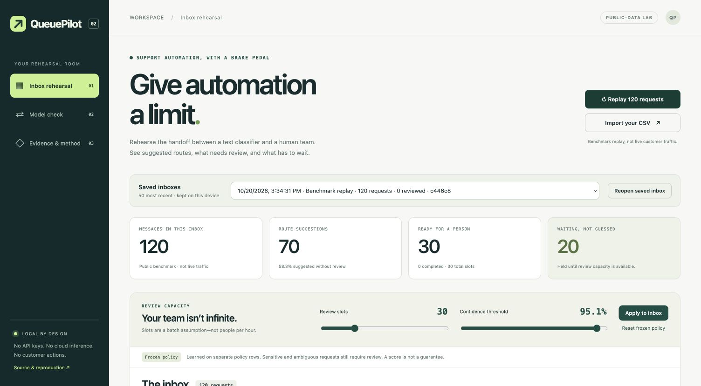

# QueuePilot

**Give automation a limit.** A local support-routing rehearsal: compare text models,
inspect every decision, and see what happens when a human review queue fills up.

[](https://github.com/brohum10/queuepilot/actions/workflows/tests.yml)

QueuePilot is the applied version-two direction of
[SelectiveML](https://github.com/brohum10/selective-ml) +
[EvalDelta](https://github.com/brohum10/evaldelta). The original digit-classification
demo remains intact. This repository moves the workflow to text requests and a
real, persistent human-routing review interface.



## Watch the workflow

https://github.com/user-attachments/assets/8b3616ad-f4dc-4c45-aa58-6a07e317c18d

[37-second demo](media/QueuePilot-Demo.mp4) · [Cover](media/QueuePilot-Cover.png) ·
[Captions](media/QueuePilot-Captions.srt) · [Recording notes](media/README.md)

The opening authored example scores **99.4%** for a duplicate-charge intent,
but it also mentions a login issue. An explicit multiple-issue rule holds it for
review. That score is **one prediction's confidence**, not benchmark accuracy.
The video then changes review capacity, inspects a persisted human route, and
shows the candidate's unfavorable release result. Actual local app capture;
no generated UI or invented customer outcomes.

## What you can do

- **Replay 120 public support questions.** Inspect suggested routes, alternatives,
  confidence, review reasons, and—when explicitly revealed—the supplied labels.
- **Give the reviewer a finite budget.** Sensitive/multi-issue heuristics are
  prioritized, then uncertainty and stable arrival order. Uncertain requests
  beyond capacity wait; they are never forced into automatic routes.
- **Bring an inbox.** Import UTF-8 `id,text[,label]` CSV, up to 1000 messages.
  Run both trained models locally. Unlabeled imports do not acquire invented
  accuracy numbers. The classifier is specific to BANKING77 intents.
- **Save a human correction.** Choose a team queue and record a reason. SQLite
  persists the original prediction and an append-only audit event, with version
  conflicts and capacity checks. Feedback never changes the test set or retrains
  the model behind the scenes.
- **Challenge a model update.** Compare the same official-test inputs under a
  fixed, checksum-pinned EvalDelta gate. Inspect queue-level uncertainty rather
  than looking only at overall accuracy.
- **Inspect the evidence.** Download portable JSON/NPZ models, splits, predictions,
  paired JSONL, reports, licenses, and an unsigned SHA-256 manifest. No pickle.

## Run it

Python **3.12 or 3.14**; no API keys, LLM service, GPU, Node build or cloud account.

```sh
git clone https://github.com/brohum10/queuepilot.git
cd queuepilot
python -m venv .venv
source .venv/bin/activate
python -m pip install -r requirements.txt
python server.py
```

Open **http://127.0.0.1:8767**. On Windows activate with `.venv\Scripts\activate`.
The checked-in reference models make the inbox usable without training first.
Start with **Replay 120 requests**, lower review slots to zero, and inspect the
waiting requests. Then try: `I was charged twice, and now I can't log in.`
The latter triggers a clearly labeled **explicit multiple-issue rule**, not a
claim of general semantic understanding.

`data/sample-import.csv` demonstrates importing without ground-truth labels.
Inbox imports/reviews live in ignored `runtime/inbox.sqlite3`. Replaying creates
a new session; previous sessions and audit events are not deleted.

## Actual reference experiment

The candidate adds word-bigram and character features to a word-unigram baseline.
It is **not an LLM**. Model complexity does not guarantee an improvement; this
fixed reference run retains the result even when the candidate fails its checks.
Exact metrics, policy failures and limitations are in
[`evidence/report.json`](evidence/report.json). No hypothetical staffing savings,
production users or fabricated deployment impact are claimed.

| Fixed reference result | Word baseline | Word + character candidate |
|---|---:|---:|
| Exact-intent accuracy, all 3072 retained official-test requests | 88.87% | 88.67% |
| Automatically suggested routes under the frozen policy | 1623 (52.83%) | 1684 (54.82%) |
| Wrong automatic suggestions | 21 | 28 |
| Accuracy **among those auto-routes only** | 98.71% | 98.34% |

The conditional accuracy is **not overall model accuracy**. All 1388 candidate
review flags remain flags—not errors corrected by humans. The candidate fixes
65 baseline mistakes and introduces 71 new mistakes. The overall comparison
passes the configured 2-point non-regression margin, but four team-queue checks
are inconclusive, so the final decision is **BLOCK**. We retain this unfavorable
result; we do not search the official test set for a nicer candidate.

Both classifiers use identical fitting rows. Vocabulary/IDF and weights are fit
only there; temperature scaling uses a separate calibration split; confidence
thresholds are selected on a separate policy split for an empirical 98% accepted
accuracy target with at least 40 eligible policy rows. Sensitive/multiple-issue
rules, a 0.12 top-two probability gap, and the threshold can require human review.
The target is **not a correctness guarantee**. Its held-out failures are retained.

The original official test split never fits vocabulary, weights, temperature or
threshold. Exact normalized text duplicates are removed before splitting, with
every exclusion retained in `evidence/splits.json`. The fixed seed is 17.

The gate compares exact-intent correctness overall and across seven explicitly
mapped team queues: paired percentile bootstrap, 2000 samples, 2 percentage-point
allowed loss, at least 50 cases per slice. Intervals are approximate and
**unadjusted per slice**. A block can mean inconclusive evidence, not a proven
regression; a pass is not production approval. Batch-amortized inference latency
is not request-level p95 or an SLA.

## Architecture

```text
Pinned BANKING77 CSVs
  → deduplicate → fit / calibration / policy / official test
  → word baseline + word/character candidate → frozen policies
  → paired EvalDelta gate + portable evidence

Local HTTP interface
  → benchmark replay OR anonymized CSV → both models
  → confidence + explicit review rules → risk-prioritized finite review slots
  → suggested route / human review / waiting
  → versioned SQLite correction log → private CSV / JSON exports
```

The frontend is framework-free HTML/CSS/JavaScript. The server uses Python's
standard library; training/inference uses scikit-learn, SciPy and NumPy. Priority
admission sorts in **O(n log n)** without looking at ground-truth labels. The
inbox limit is 1000 requests; the offline planner handles the full benchmark.

## Reproduce and test

**82 automated tests**, exercised on Python 3.12 and 3.14. Public
[GitHub Actions](https://github.com/brohum10/queuepilot/actions/workflows/tests.yml)
also verifies the evidence bundle and performs fresh training on both versions.
Passing software tests does not mean the candidate passes its model-release gate.

```sh
python -m unittest -v
python artifacts.py --verify evidence/queuepilot-evidence.zip
OPENBLAS_NUM_THREADS=1 python train.py --output evidence/rebuilt/fresh-run
```

Training refuses an existing output directory. It verifies pinned data/comparator
hashes, trains both architectures under the same fixed protocol, round-trips the
portable model export, and retains all predictions and an identical-model control.
Training time and latency vary by hardware. Do not substitute the evidence from
a different run into claims about the recorded demo.

To rebuild the public bundle after deliberate source/artifact changes:
`python artifacts.py --build`. Review `evidence/manifest.json` first; the bundle
includes only reference artifacts and project sources, never runtime inbox data.
Unsigned hashes establish file consistency, not authenticity or validity.

## Boundaries that matter

- BANKING77 is a **crowdsourced English, single-intent benchmark**, not operational
  customer traffic. Its banking vocabulary does not establish general helpdesk
  performance, multi-language support, urgency detection, or multi-intent skill.
- Multiple-issue/sensitive rules are visible heuristics. The separately authored
  challenge fixtures were developed alongside them, not a blind OOD benchmark.
- Threshold changes in the inbox are **retrospective what-ifs**. They do not
  change the frozen report. Select a new policy using separate data and fresh
  evaluation, not the displayed test outcomes.
- Review slots are a **batch-capacity assumption**, not measured human throughput.
  A flag is not a correction, and a route is not a resolved customer issue.
- No messages are sent, money moved, accounts changed or financial decisions made.
- The server binds only to `127.0.0.1`, checks Host/Origin/session tokens on writes,
  limits request sizes, allowlists static files, and does not log message bodies.
  It has **no multi-user authentication**. Do not expose it to the internet.
- Imports and notes stay locally in plaintext SQLite. Basic email/number masking
  is not comprehensive PII protection. Use public/anonymized text only.

## Attribution

Dataset: Casanueva et al., *Efficient Intent Detection with Dual Sentence
Encoders* (2020), [PolyAI BANKING77](https://github.com/PolyAI-LDN/task-specific-datasets),
CC BY 4.0. Files are retained unmodified; see [data provenance](data/README.md).
EvalDelta is vendored at `901c809ac52147c5ce4d79006cc720476457d252`, verified by
SHA-256 and retaining its MIT license. QueuePilot code is MIT.

Developed with AI assistance. This is an inspectable learning/prototype tool,
not novel ML research, production infrastructure or evidence of business impact.
